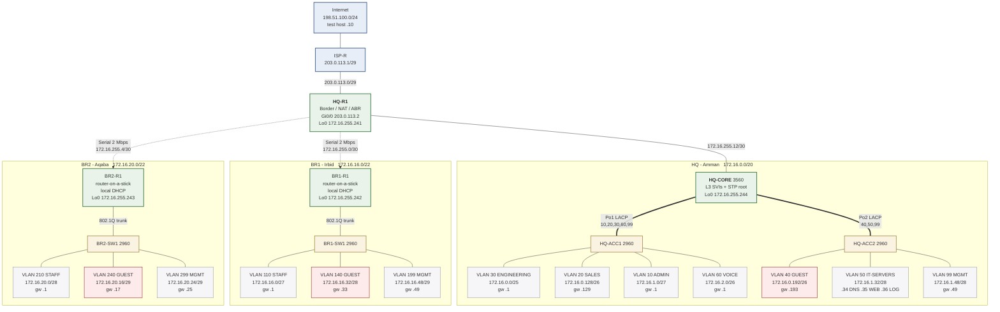
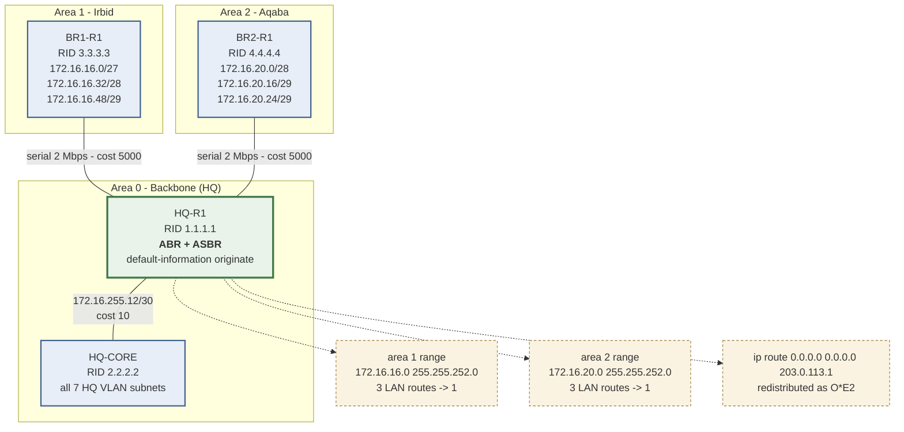
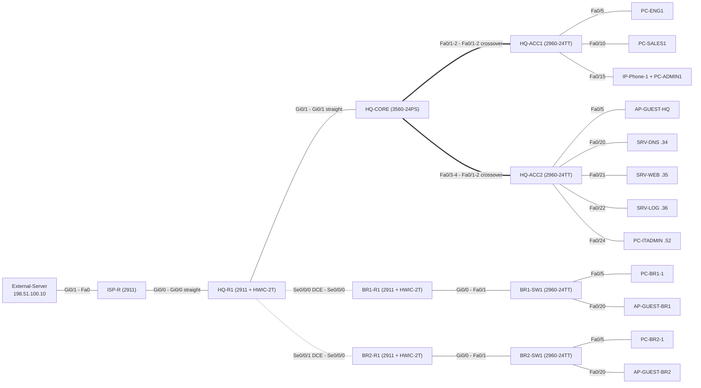

# TechNova: a network design for a three-site company

- **Author:** Saeed Ramadan
- **Deliverable:** Multi-site enterprise network design, with a Cisco Packet Tracer build guide and test plan
- **Design space:** `172.16.0.0/16` (private) + `203.0.113.0/29` (ISP-assigned public)
- **Status:** design complete (addressing, configurations, test plan). It has not yet been
  built and run in Packet Tracer, so the *Actual* column of the test plan is still empty.

---

## 1. What this project is

I designed the network for a made-up company, **TechNova Solutions**, with a head office in
Amman and two branches in Irbid and Aqaba. I wanted to take it through every step a real
design goes through: requirements, logical design, addressing, switching, routing, services,
security, a build guide, a test plan and an evaluation.

Each file in `configs/` is a complete Cisco IOS configuration you can paste into a device.
Every address in `docs/03-ip-addressing-plan.md` comes from one block using VLSM, and I
cross-checked them against the configurations.

## 2. Repository layout

```
technova-network-design/
├── README.md                         ← you are here
├── TechNova-Network-Design-Report.docx  ← the full design report (Word)
├── TechNova-Network-Design-Report.pdf   ← same report, fixed formatting
├── docs/
│   ├── 01-requirements-and-scope.md  ← business + technical requirements
│   ├── 02-logical-design.md          ← topology, hierarchy, device roles
│   ├── 03-ip-addressing-plan.md      ← VLSM derivation + master address table
│   ├── 04-vlan-and-switching.md      ← VLANs, trunks, EtherChannel, STP
│   ├── 05-routing-design.md          ← multi-area OSPFv2, summarisation
│   ├── 06-services-nat-dhcp.md       ← DHCP, DNS, NAT/PAT, NTP, Syslog
│   ├── 07-security-hardening.md      ← ACLs, port security, SSH, DHCP snooping
│   ├── 08-test-plan-and-verification.md ← 60 test cases + expected output
│   ├── 09-build-guide-packet-tracer.md  ← step-by-step build order
│   └── 10-final-report.md            ← the full design report (Markdown)
├── configs/                          ← 9 paste-ready IOS configurations
│   ├── ISP-R.txt      HQ-R1.txt      HQ-CORE.txt
│   ├── HQ-ACC1.txt    HQ-ACC2.txt
│   ├── BR1-R1.txt     BR1-SW1.txt
│   └── BR2-R1.txt     BR2-SW1.txt
├── diagrams/                         ← Mermaid source for all figures
│   ├── logical-topology.mmd
│   ├── physical-topology.mmd
│   └── ospf-areas.mmd
└── tools/
    └── embed-diagrams.py             ← re-renders the README diagrams from diagrams/*.mmd
```

## 3. Design summary (one page)

| Layer | Decision | Rationale |
|---|---|---|
| Topology | Hub-and-spoke WAN, collapsed core at HQ | Matches a small enterprise with a single data centre; cheapest link count |
| Addressing | VLSM from `172.16.0.0/16`, one contiguous block per site | Enables per-site route summarisation and keeps ACLs short |
| Switching | 802.1Q trunks, LACP EtherChannel core↔access, Rapid-PVST+ | Link redundancy without spanning-tree convergence penalty |
| Inter-VLAN routing | SVIs on an L3 switch at HQ; router-on-a-stick at branches | HQ traffic volume justifies hardware switching; branches do not |
| Routing protocol | OSPFv2, areas 0 / 1 / 2, MD5 authenticated | Open standard, fast convergence, area ranges summarise branch routes |
| Internet edge | PAT for all users, one static NAT for the web server | Single public /29, must be conserved |
| Security | Layered: edge ACL, guest isolation, port security, DHCP snooping, SSH-only management | Defence in depth; each control has a named threat it answers |

**Device inventory:** 4 routers (1 ISP-simulating), 1 multilayer switch, 4 access
switches, 3 servers, end hosts and IP phones.

## 4. Topology

<!-- DIAGRAMS:START - generated by tools/embed-diagrams.py, do not edit by hand -->

### Logical topology

Sites, devices and the addressing each one carries.



<sub>Source: [`diagrams/logical-topology.mmd`](diagrams/logical-topology.mmd)</sub>

### OSPF areas and summarisation

How each branch's routes are summarised into one route at the area border.



<sub>Source: [`diagrams/ospf-areas.mmd`](diagrams/ospf-areas.mmd)</sub>

### Physical topology

Ports and cable types, as planned for the Packet Tracer build.



<sub>Source: [`diagrams/physical-topology.mmd`](diagrams/physical-topology.mmd)</sub>

<!-- DIAGRAMS:END -->

## 5. How to reproduce the build

1. Read `docs/09-build-guide-packet-tracer.md`. It lists the exact device
   models, modules and cable types, in the order to place them.
2. Place and cable the devices.
3. Paste each file from `configs/` into the matching device
   (`enable` → `configure terminal` → paste → `end` → `write memory`).
4. Work through `docs/08-test-plan-and-verification.md`. Each of the 60 tests
   lists the command to run and the result to expect. (I haven't run them yet;
   see the status line at the top.)

## 6. What this design doesn't cover

These limits are discussed in §9 of the report:

- The ISP and the "Internet" are simulated by one router and one server. No
  BGP, no real upstream.
- The edge filter is a **stateless** extended ACL. A real edge needs a stateful
  firewall (Cisco ZBF or ASA), which I list as future work.
- Each branch has a single WAN link. A second link per branch is only listed as
  future work (§9.2 of the report).
- Wireless is represented by access points on the guest VLAN; WLC-based
  wireless design is out of scope.
